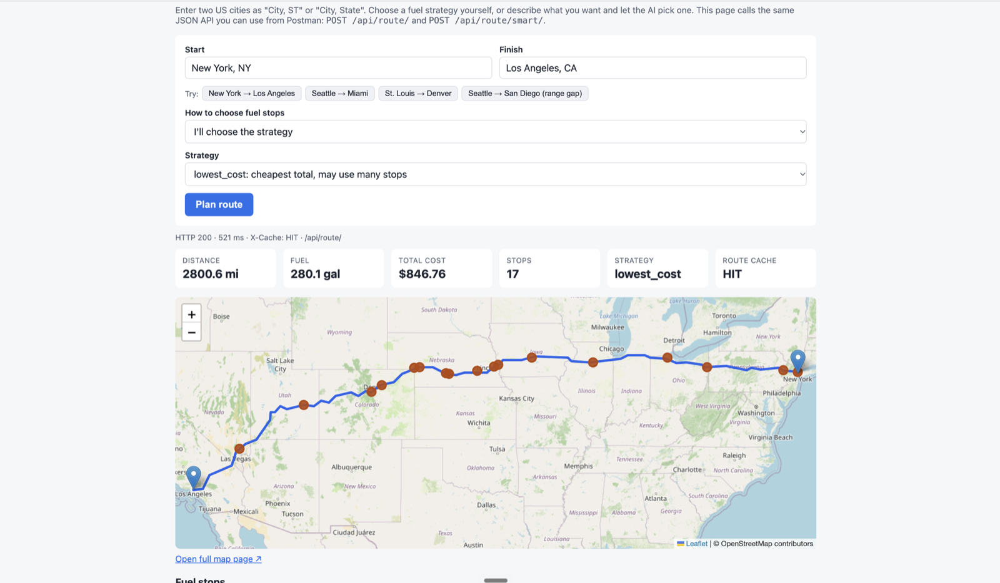

# Fuel Route Planner

A Django REST API that plans a road trip between two US cities and chooses **where to buy
fuel, and how much**, so the trip costs as little as possible. It uses real truck stop
prices, a 500-mile range and 10 miles per gallon.

**Live demo: <https://fuel.lazymonk.si>**

```
POST /api/route/  {"start": "New York, NY", "finish": "Los Angeles, CA"}

→ 2,800.6 miles · 17 fuel stops · 280.06 gallons · $846.76
  + every stop (name, city, price, gallons, cost, mile marker)
  + the route as GeoJSON and a link to an interactive map
```



*New York → Los Angeles on the live web page: totals, cache status, and the route with all 17
fuel stops on the map.*

| Document | What's in it |
|---|---|
| **README.md** (this file) | How to test it, architecture, how AI is used, key decisions, API reference |
| [DECISIONS.md](DECISIONS.md) | Every decision with its reasoning and measurements, phase by phase |
| [DEPLOY.md](DEPLOY.md) | Step-by-step AWS deployment (EC2, Docker Compose, HTTPS) |

---

## Contents

1. [Test the API](#1-test-the-api)
2. [What was asked and what was delivered](#2-what-was-asked-and-what-was-delivered)
3. [Architecture](#3-architecture)
4. [The fuel algorithm and the three strategies](#4-the-fuel-algorithm-and-the-three-strategies)
5. [How AI is used](#5-how-ai-is-used)
6. [Key decisions](#6-key-decisions)
7. [API reference](#7-api-reference)
8. [Run it locally](#8-run-it-locally)
9. [Tests](#9-tests)
10. [Caching](#10-caching)
11. [Configuration](#11-configuration)
12. [Deployment](#12-deployment)
13. [Data](#13-data)
14. [Project structure](#14-project-structure)
15. [Assumptions and limitations](#15-assumptions-and-limitations)
16. [Troubleshooting](#16-troubleshooting)

---

## 1. Test the API

### In a browser (no tools needed)

Open **<https://fuel.lazymonk.si>**, enter two cities, and click **Plan route**. The page calls
the same JSON API as Postman and shows the totals, the map, every stop, a comparison of the
three strategies, and the raw request and response with an equivalent `curl` command.
One-click examples include a trip that fails on purpose (Seattle → San Diego).

### With curl

```bash
# 1. Plan a trip (default strategy: lowest_cost)
curl -X POST https://fuel.lazymonk.si/api/route/ \
  -H "Content-Type: application/json" \
  -d '{"start": "Chicago, IL", "finish": "Houston, TX"}'

# 2. Same trip, a different strategy
curl -X POST https://fuel.lazymonk.si/api/route/ \
  -H "Content-Type: application/json" \
  -d '{"start": "Chicago, IL", "finish": "Houston, TX", "strategy": "fewest_stops"}'

# 3. Let the AI pick the strategy from plain English
curl -X POST https://fuel.lazymonk.si/api/route/smart/ \
  -H "Content-Type: application/json" \
  -d '{"start": "Chicago, IL", "finish": "Houston, TX", "preference": "I am in a hurry, I do not want many stops"}'

# 4. See the cache: run twice, first X-Cache: MISS, then HIT
curl -s -D - -o /dev/null -X POST https://fuel.lazymonk.si/api/route/ \
  -H "Content-Type: application/json" \
  -d '{"start": "Denver, CO", "finish": "Dallas, TX"}' | grep -i x-cache

# 5. A clear error: 400 unknown_city
curl -X POST https://fuel.lazymonk.si/api/route/ \
  -H "Content-Type: application/json" \
  -d '{"start": "Atlantis, NY", "finish": "Houston, TX"}'
```

Map for a trip: <https://fuel.lazymonk.si/api/route/map/?start=Chicago%2C+IL&finish=Houston%2C+TX&strategy=lowest_cost>

### With Postman

1. New request: **POST** `https://fuel.lazymonk.si/api/route/`
2. **Body → raw → JSON**: `{"start": "New York, NY", "finish": "Los Angeles, CA"}`
3. **Send**. Open `map_url` from the response in a browser (prefix it with the host).
4. For the AI picker, POST to `/api/route/smart/` with `"preference"` instead of `"strategy"`.

To run everything on your own machine instead, see [Run it locally](#8-run-it-locally): it
takes four commands with Docker.

> The live server is rate limited per IP (120 requests/hour on `/api/route/`, 20/hour on
> `/api/route/smart/`). Locations are `"City, ST"` or `"City, State Name"`, US only.

---

## 2. What was asked and what was delivered

### The brief

| Requirement | How it's met |
|---|---|
| Start and finish anywhere in the USA | Offline table of 29,738 US cities; `"City, ST"` or `"City, State Name"`; non-US places are rejected with a clear error |
| Map of the route | Route returned as GeoJSON, plus an interactive Leaflet map page (`map_url`) |
| Cost-effective fuel stops, 500-mile range | A greedy optimizer that matched the theoretical minimum cost on all 8 test routes |
| 10 miles per gallon, total fuel cost | Gallons and cost per stop and in total. Total gallons always equals miles ÷ 10 (checked in code and tests) |
| Use the provided fuel price CSV | Cleaned and geocoded: 6,614 stations loaded, 1.84% unmatched (almost all Canadian) |
| Free routing API, ideally one call | OSRM public server, **exactly one call per unique trip**, zero geocoding calls |
| Latest stable Django | Django 6.1.2, Django REST Framework 3.18.3 |
| Fast | About 0.7 s for a new trip, **about 2 ms** when the route is cached |

### Beyond the brief

| Add-on | Why |
|---|---|
| **Three fuel strategies** (`lowest_cost`, `balanced`, `fewest_stops`) | The cheapest plan can mean many stops with tiny purchases. Measured trade-offs let the user choose ([section 4](#4-the-fuel-algorithm-and-the-three-strategies)) |
| **AI strategy picker** (`/api/route/smart/`) | Chooses one of the three strategies from a plain-English preference, with one LLM call and a safe fallback ([section 5](#5-how-ai-is-used)) |
| **Web page** at `/` | Reviewers can test everything in a browser |
| **Redis cache with stampede protection** | One OSRM call per trip even under concurrent requests; keeps working if Redis goes down |
| **Structured errors** | Every error has a stable `code`, a `message` and `details`, with meaningful HTTP status codes |
| **Rate limits** | A public deployment can't run up LLM costs or overload the free OSRM server |
| **Production deployment** | Gunicorn, Caddy with automatic HTTPS, AWS guide; running at fuel.lazymonk.si |
| **Data load report** | `reports/load_stops.json` records counts and every skipped station |
| **100 automated tests** | No internet, Redis or API key needed |

---

## 3. Architecture

### 3.0 How it works at a glance


The next sections show the same flow in technical detail: the services involved (3.1),
each step of a request (3.2) and how the code is organised (3.3).

### 3.1 System overview

![System architecture: Postman/curl and the browser reach the server over HTTPS. On one server (Docker Compose), Caddy handles HTTPS with only ports 80 and 443 open and forwards to Django + Django REST Framework on Gunicorn with 3 workers (city lookup, fuel optimizer, AI plan picker). Django uses PostgreSQL 17 + PostGIS 3.5 (6,614 fuel stations) and Redis 7.4 (24-hour route cache, rate-limit counters) on an internal network never exposed to the internet. Outside services: OSRM for the driving route (1 call per new trip), OpenRouter for the AI model (at most 1 call per AI request), and OpenStreetMap map tiles loaded by the browser.](docs/images/architecture.png)

Only Caddy is reachable from the internet. The database and Redis sit on an internal Docker
network, and the app makes at most two kinds of outside calls: OSRM once per new trip, and
OpenRouter at most once per AI request. Map tiles go straight from the browser to OpenStreetMap.

| Component | Role | Why this choice |
|---|---|---|
| **Django REST Framework** | API, validation, error handling | Required by the brief; serializers and exception handling built in |
| **PostgreSQL + PostGIS** | Stores stations as geography points; finds stations near the route | `ST_DWithin` on a spatial index filters 6,614 stations to ~440 in under 0.1 s |
| **Redis** | Caches routed trips; counts rate limits | Shared by all Gunicorn workers and survives restarts; LFU eviction keeps popular routes |
| **OSRM** | Driving route and distance | Free, no API key, route and distance in one call |
| **Offline cities table** | City name → coordinates | Zero geocoding API calls; fast and predictable |
| **OpenRouter** | LLM for the optional strategy picker | Many models through one API; per-key spending cap |
| **Caddy + Gunicorn** | HTTPS and the production app server | Automatic certificates with a 4-line config; multiple workers |

### 3.2 What happens on one request

```
POST /api/route/ {"start": "St. Louis, MO", "finish": "Denver, CO", "strategy": "balanced"}

 1. Validate input                      serializer: fields, lengths, strategy name       → 400
 2. Resolve both cities                 offline table, "St." → "Saint", state names      → 400 unknown_city
 3. Cache lookup                        key: normalized "start|finish"                   → X-Cache: HIT, skip to 7
 4. Lock the trip                       only one request per trip calls OSRM; others wait for its result
 5. One OSRM call                       route line + driving distance (15 s timeout)     → 422 / 502 / 504
 6. Corridor search                     PostGIS: stations within 10 miles of the route;
                                        mile marker = position along the route × distance
                                        → cache the route + stations for 24 h
 7. Optimizer                           chosen strategy picks stops and gallons (< 1 ms) → 422 range_gap
 8. Response                            totals, stops, GeoJSON route, map link
```

The optimizer runs on every request, but the route is cached, so switching strategies,
using a different spelling of the same city (`"st. louis, mo"` and `"Saint Louis, Missouri"`)
or opening the map never calls OSRM again.

### 3.3 Code layers

```
fuel/views.py ─────────── HTTP only: parse request, map errors to status codes, set X-Cache
     │
fuel/services.py ──────── orchestration: cached trip lookup, stampede lock, strategy comparison
     │
     ├── fuel/locations.py    city parsing and lookup (offline table)
     ├── fuel/routing.py      OSRM call, PostGIS corridor search, mile markers
     ├── fuel/optimizer.py    the three strategies; pure Python, no Django
     └── fuel/router.py       AI strategy picker: one LLM call, validation, fallback
```

- **Each layer raises plain Python errors;** only `views.py` turns them into HTTP responses.
  The optimizer has no Django or HTTP code, so it is tested in isolation and could be reused anywhere.
- **The cache stores plain data only** (lists, floats, dicts), never database or geometry
  objects, so it is safe to serialize.
- **Coordinates are `[lon, lat]` everywhere** (OSRM, GeoJSON, PostGIS) and flipped to
  `[lat, lon]` in exactly one place: the Leaflet map code.

---

## 4. The fuel algorithm and the three strategies

### Rules shared by all strategies

- **The tank starts empty.** The first stop is the cheapest station in the first 50 miles
  (widening 50 miles at a time if there is none), and it also pays for the fuel used to get
  there. So the total cost covers the whole trip.
- **The range is 500 miles.** If any stretch of the route has no station within 500 miles,
  the API returns `422 range_gap` with the mile and the last station, instead of a broken plan.
- **Total gallons = total miles ÷ 10**, always. This is asserted in code and checked on 900
  random plans in the tests.

### The greedy rule (`lowest_cost`)

At each stop, look 500 miles ahead:

1. If a **cheaper** station is in range, buy just enough fuel to reach the **first** one.
2. Otherwise, if the **finish** is in range, buy just enough to finish.
3. Otherwise **fill up** and drive to the **cheapest** station in range.

This is the classic optimal fuel-stop strategy. It matched the theoretical minimum cost on
all 8 test routes.

### Why three strategies

The cheapest plan sometimes buys tiny amounts: for example 0.11 gallons at one stop because
a station 1.1 miles later is a cent cheaper. Real drivers care about stops too, so I measured
two alternatives on 8 cross-country routes:

| Strategy | Rule | Stops (8 trips) | Cost (8 trips) | vs `lowest_cost` |
|---|---|---|---|---|
| **`lowest_cost`** (default) | The greedy rule above | 79 | $4,088.41 | — |
| **`balanced`** | A station only counts as cheaper if it saves **at least 5¢/gal** | 57 (**−28%**) | $4,101.52 | **+0.32%** |
| **`fewest_stops`** | Never chase a cheaper station: fill up, go to the cheapest in range | 48 (**−39%**) | $4,165.21 | **+1.88%** |

Routes: New York → Los Angeles, Chicago → Houston, Seattle → Miami, Boston → Denver,
Atlanta → Phoenix, Dallas → Minneapolis, San Francisco → Salt Lake City, Philadelphia → Nashville.
The 5¢ margin was chosen after also measuring 2¢ (−13% stops, +0.04%) and 10¢ (−34%, +0.42%).

Example, Chicago → Houston (1,103 miles):

| Strategy | Stops | Total cost |
|---|---|---|
| `lowest_cost` | 8 | $323.35 |
| `balanced` | 5 | $324.88 (+$1.53) |
| `fewest_stops` | 4 | $329.74 (+$6.39) |

All three share one engine, `plan_fuel_stops(min_saving=..., chase_cheaper=...)`. They are
selected with one optional field, `"strategy"`, on the same endpoint.

---

## 5. How AI is used

### The problem it solves

Users don't think in strategy names. They say things like *"I'm in a hurry"* or *"cheapest
possible, I don't mind stopping"*. `POST /api/route/smart/` takes that sentence and picks the
matching strategy.

### A workflow with one AI decision, not an autonomous agent

The steps never change: get the route, compute the plans, pick one. Only **which strategy**
is decided at runtime. So this is a fixed workflow with a single LLM decision (a *router*),
not an agent that loops and chooses tools. That makes it fast (one call), cheap and
predictable. LangGraph or a separate microservice would add moving parts for no benefit.

```
POST /api/route/smart/ {start, finish, preference}
  1. Validate input (preference ≤ 300 characters)
  2. Get the route (cache or 1 OSRM call)
  3. Run ALL three strategies                 ← code, < 1 ms each, no extra OSRM calls
       └─ trip infeasible? → return the 422 error, no LLM call
  4. Build a comparison table                 ← code: stops, cost, +$ and +% vs lowest_cost
  5. Skip the LLM when it can't matter:
       no preference → lowest_cost ("default")
       all three plans identical → lowest_cost ("identical")
       no API key → lowest_cost ("fallback")
  6. ONE LLM call: preference + comparison table → {strategy, reason}
  7. Validate the answer; anything wrong → lowest_cost ("fallback" + why)
  8. Return the chosen plan + the decision + the comparison
```

### Design principles

| Principle | How |
|---|---|
| **Code does the math, the LLM only chooses** | The LLM receives the numbers already computed and never calculates. Every number in the response comes from the optimizer |
| **Structured output only** | The model must call a `choose_strategy` tool whose `strategy` field is an enum of the three names. Free text is never parsed |
| **Never fails because of AI** | No key, a 5 s timeout, an HTTP error or an invalid answer all fall back to `lowest_cost` with HTTP 200, and the response says why (`decided_by`, `fallback_reason`) |
| **Prompt-injection resistant** | The preference is wrapped in tags and treated only as a preference; the worst a malicious input can do is pick one of three valid plans |
| **Cost-controlled** | ~$0.0001 per decision (`anthropic/claude-haiku-5.5` via OpenRouter), skipped when it can't change anything, rate limited to 20/hour per IP, and the API key has a spending cap |
| **Testable without a network** | All AI tests use a faked LLM; API keys are forced empty under `manage.py test` |

Example response fields:

```json
"decision": {
  "strategy": "fewest_stops",
  "reason": "Half the stops (4 vs 8) for $6.39 more (+1.98%).",
  "decided_by": "llm",
  "fallback_reason": null
},
"comparison": [
  {"strategy": "lowest_cost",  "stops": 8, "total_cost": 323.35, "extra_cost": 0.0,  "extra_cost_pct": 0.0},
  {"strategy": "balanced",     "stops": 5, "total_cost": 324.88, "extra_cost": 1.53, "extra_cost_pct": 0.47},
  {"strategy": "fewest_stops", "stops": 4, "total_cost": 329.74, "extra_cost": 6.39, "extra_cost_pct": 1.98}
]
```

The provider is configurable: OpenRouter (default) or the Anthropic API directly
(`STRATEGY_ROUTER_PROVIDER`).

---

## 6. Key decisions

The full list, with measurements, is in [DECISIONS.md](DECISIONS.md). The most important:

| Area | Decision | Why |
|---|---|---|
| Routing | OSRM public server, one call per unique trip | Free, no key; route and distance in one response |
| Geocoding | Offline US cities table, no geocoding API | The CSV's addresses (`I-44, EXIT 283`) can't be geocoded reliably; keeps the trip to one external call |
| Station search | PostGIS `ST_DWithin`, 10-mile corridor around the route | Indexed spatial filter: ~440 of 6,614 stations for a coast-to-coast trip in < 0.1 s |
| Mile markers | Each station projected onto the route line | Cheap and accurate enough to order stops and size purchases |
| Route detail | OSRM `overview=simplified` | Smaller response and map; measured cost: ~2% of corridor stations missed |
| Duplicate stations in the CSV | Keep the lowest price per station ID | 8,151 rows for 6,738 stations |
| Starting fuel | Empty tank, first stop pays for reaching it | The total covers the whole trip |
| Strategies | Three, one endpoint, optional `strategy` field | Measured trade-offs; one URL for clients |
| Caching | Cache the **route** (24 h), recompute the **plan** per request | All strategies share one OSRM call; the optimizer takes < 1 ms |
| Cache under load | Lock per trip: one request calls OSRM, others wait for its result | Measured: 8 parallel requests → 1 OSRM call |
| Cache failures | Redis errors are treated as a cache miss | Measured: Redis stopped → API still answers in ~0.9 s |
| Errors | One shape, stable codes, specific statuses (400 / 422 / 429 / 502 / 504) | Clients and agents can react to the `code`; never leaks raw upstream errors |
| AI | One LLM decision inside fixed steps; code does the math; always a fallback | Fast, cheap, predictable; works without a key |
| Rate limits | Per IP, counted in Redis; real client IP behind the proxy | Protects LLM credits and the free OSRM server |
| Deployment | One EC2 server with Docker Compose, Caddy HTTPS, Gunicorn | Production-shaped at assessment cost; ECS + RDS + ElastiCache noted as the at-scale path |

---

## 7. API reference

Base URL: `https://fuel.lazymonk.si` (live) or `http://localhost:8000` (local).

### `POST /api/route/`

**Request**

| Field | Type | Required | Description |
|---|---|---|---|
| `start` | string | yes | `"City, ST"` or `"City, State Name"`, e.g. `"St. Louis, MO"`, `"Los Angeles, California"` |
| `finish` | string | yes | Same format |
| `strategy` | string | no | `lowest_cost` (default), `balanced`, `fewest_stops` |

**Response `200 OK`** (lists shortened)

```json
{
  "start": "New York, NY",
  "finish": "Los Angeles, CA",
  "strategy": "lowest_cost",
  "total_distance_miles": 2800.6,
  "total_gallons": 280.06,
  "total_cost": 846.76,
  "fuel_stops": [
    {
      "name": "7-ELEVEN #40084",
      "city": "Palisades Park",
      "state": "NJ",
      "price": 3.099,
      "mile_marker": 3.0,
      "gallons": 6.42,
      "cost": 19.89,
      "lon": -73.995436,
      "lat": 40.846238
    }
  ],
  "route": {
    "type": "LineString",
    "coordinates": [[-73.996496, 40.748595], [-74.226568, 40.893518]]
  },
  "map_url": "/api/route/map/?start=New+York%2C+NY&finish=Los+Angeles%2C+CA&strategy=lowest_cost"
}
```

| Field | Meaning |
|---|---|
| `total_distance_miles` | Driving distance from OSRM |
| `total_gallons` | Always `total_distance_miles / 10` |
| `total_cost` | Sum of all stop costs, USD |
| `fuel_stops[].mile_marker` | Approximate distance from the start |
| `fuel_stops[].gallons` / `cost` | Fuel bought at that stop and its cost |
| `fuel_stops[].lon` / `lat` | Stop location (city center) |
| `route` | GeoJSON LineString, `[longitude, latitude]` |
| `map_url` | Interactive map for this trip |

Response header `X-Cache: HIT` or `MISS` shows whether the route came from the cache.

### `POST /api/route/smart/`

| Field | Type | Required | Description |
|---|---|---|---|
| `start`, `finish` | string | yes | As above |
| `preference` | string | no | What the driver wants, up to 300 characters |

Returns the same body as `/api/route/` for the chosen strategy, plus `decision` and
`comparison` (see [section 5](#5-how-ai-is-used)).

| `decided_by` | When | LLM called? |
|---|---|---|
| `llm` | The model chose a valid strategy | yes, once |
| `default` | No preference given | no |
| `identical` | All three strategies give the same plan | no |
| `fallback` | `fallback_reason`: `no_api_key`, `timeout`, `llm_error` or `invalid_response` | maybe |

### `GET /api/route/map/?start=...&finish=...&strategy=...`

HTML page with the route and stops on a Leaflet map. Same parameters and errors as the API.

### `GET /`

The web page for testing both endpoints in a browser.

### Errors

Every error has one shape:

```json
{
  "error": {
    "code": "range_gap",
    "message": "No fuel station within 500 miles after mile 259 (Halsey, OR).",
    "details": {"from_mile": 259.3, "from_stop": "Halsey, OR", "max_range": 500}
  }
}
```

| HTTP | `code` | When | Example |
|---|---|---|---|
| 400 | `invalid_input` | Missing field, unknown strategy, no state | `"New York"` |
| 400 | `unknown_city` | City not in the US cities table | `"Atlantis, NY"`, `"Toronto, ON"` |
| 400 | `parse_error` | Malformed JSON | |
| 405 | `method_not_allowed` | Wrong HTTP method | `GET /api/route/` |
| 415 | `unsupported_media_type` | Body is not JSON or form data | |
| 422 | `no_route` | No drivable road | Honolulu, HI → Denver, CO |
| 422 | `no_station_near_start` | No station within reach of the start | Eureka, CA → San Diego, CA |
| 422 | `range_gap` | More than 500 miles without a station | Seattle, WA → San Diego, CA |
| 429 | `throttled` | Rate limit reached; `details.retry_after_seconds` and a `Retry-After` header | |
| 502 | `routing_unavailable` | The routing service failed | |
| 504 | `routing_timeout` | The routing service took more than 15 s | |

---

## 8. Run it locally

**Prerequisites:** Docker with Compose v2, port 8000 free, internet access (OSRM and map tiles).

```bash
cp .env.example .env                                            # defaults work as they are
docker compose up -d --build                                    # db, redis, web
docker compose exec web python manage.py migrate                # create tables
docker compose exec web python manage.py loaddata truckstops    # 6,614 stations
```

Open **<http://localhost:8000/>**, or:

```bash
curl -X POST http://localhost:8000/api/route/ \
  -H "Content-Type: application/json" \
  -d '{"start": "New York, NY", "finish": "Los Angeles, CA"}'
```

Optional: put an OpenRouter key in `.env` as `OPENROUTER_API_KEY=...` and run
`docker compose up -d` to enable the AI picker. Without it, `/api/route/smart/` still works
and uses `lowest_cost`.

| Service | Runs |
|---|---|
| `db` | PostgreSQL 17 + PostGIS 3.5 |
| `redis` | Redis 7.4, 256 MB, LFU eviction |
| `web` | Django on `http://localhost:8000` (auto-reload) |

```bash
docker compose stop        # stop, keep data
docker compose down -v     # remove everything, including the database
```

---

## 9. Tests

```bash
docker compose exec web python manage.py test fuel      # Ran 100 tests ... OK
```

| File | Covers |
|---|---|
| `test_optimizer.py` | Every rule of all three strategies, range gaps, no station near start, gallons invariant on 900 random plans |
| `test_locations.py` | City/state parsing, `St.`/`Ft.`/`Mt.` and state-name normalization |
| `test_routing.py` | OSRM success, timeout, failure, "no route" (network faked); 10-mile corridor and mile markers in PostGIS |
| `test_api.py` | Response shape, each strategy, the map page, every error code |
| `test_cache.py` | `X-Cache` hit/miss, shared entries across spellings, stampede lock, Redis down, failures never cached |
| `test_router.py` | AI picker: every `decided_by` path, invalid answers, timeouts, requests to OpenRouter and Anthropic (faked); rate limits per IP, behind a proxy and with Redis down; the web page |

Tests need no internet, Redis or API key: the network and LLM are faked, the cache is
in-memory, and API keys are forced empty. Key rules were mutation-checked: breaking the 5¢
rule, the first-cheaper rule, the stampede-lock fixes or the AI answer validation makes
tests fail.

---

## 10. Caching

Each trip's route and nearby stations are cached in Redis for 24 hours under the normalized
city pair; the strategy runs fresh on each request.

| Behavior | Detail |
|---|---|
| Key | `fuelroute:1:route:saint-louis\|MO\|denver\|CO` (same for every spelling) |
| Concurrent requests | One request per trip calls OSRM; the others wait up to 20 s for its result |
| Redis down or frozen | Treated as a miss (1 s timeouts); the API keeps answering; a warning is logged |
| Errors | Never cached |
| Eviction | `allkeys-lfu`, 256 MB |
| Invalidate everything | Bump `VERSION` in `CACHES` (`spotter/settings.py`) |

```bash
docker compose exec redis redis-cli KEYS "fuelroute:*"
docker compose exec redis redis-cli FLUSHDB          # clear the cache
```

---

## 11. Configuration

Development settings are in `.env` (copy of `.env.example`); production uses
`.env.production.example` (see [DEPLOY.md](DEPLOY.md)). `.env` is never committed.

| Variable | Default | Description |
|---|---|---|
| `POSTGRES_DB` / `USER` / `PASSWORD` | `spotter` | Database |
| `POSTGRES_HOST` / `PORT` | `db` / `5432` | Database host |
| `REDIS_URL` | `redis://redis:6379/0` | Cache; unset → in-memory cache |
| `OPENROUTER_API_KEY` | empty | Enables the AI picker; empty → falls back to `lowest_cost` |
| `STRATEGY_ROUTER_PROVIDER` | `openrouter` | `openrouter` or `anthropic` |
| `STRATEGY_ROUTER_MODEL` | `anthropic/claude-haiku-5.5` | Model (`claude-haiku-5-5` with the `anthropic` provider) |
| `ANTHROPIC_API_KEY` | empty | Only for the `anthropic` provider |
| `SMART_RATE_LIMIT` / `ROUTE_RATE_LIMIT` | `20/hour` / `120/hour` | Per-IP limits |
| `DEBUG` | `True` | `False` in production |
| `SECRET_KEY` | dev key | Required when `DEBUG=False` |
| `DOMAIN` | empty | Production domain; sets allowed hosts. Required when `DEBUG=False` |

After editing `.env`, run `docker compose up -d` (a plain `restart` does not reload it).

---

## 12. Deployment

The live demo runs on one AWS EC2 server with `docker-compose.prod.yml`. Full guide:
[DEPLOY.md](DEPLOY.md).

| | Development | Production |
|---|---|---|
| App server | `runserver`, code mounted | Gunicorn, 3 workers, 60 s timeout |
| HTTPS | — | Caddy, automatic Let's Encrypt certificate, HTTP → HTTPS |
| Settings | `DEBUG=True` | `DEBUG=False`, secret key required, only the configured domain accepted |
| Exposed ports | 8000 | 80 and 443 only; database and Redis are internal |
| Startup | Manual migrate | Migrations and static files on every start; `restart: unless-stopped`; rotated logs |

At larger scale the same containers would move to ECS, RDS for PostgreSQL with PostGIS, and
ElastiCache behind a load balancer, with secrets in AWS Parameter Store or Secrets Manager
and a self-hosted OSRM.

---

## 13. Data

| File | Contents |
|---|---|
| `data/fuel-prices-for-be-assessment.csv` | Provided fuel prices (8,151 rows, 6,738 stations) |
| `data/us-cities.csv` | 29,738 US cities with coordinates, from [kelvins/US-Cities-Database](https://github.com/kelvins/US-Cities-Database) (MIT, `data/us-cities.LICENSE`) |
| `fuel/fixtures/truckstops.json` | Cleaned stations, ready to load |
| `reports/load_stops.json` | Report of the last data load |

Rebuild from the raw CSV: `docker compose exec web python manage.py load_stops`. It keeps the
lowest price per station, rounds prices to 3 decimals, matches each station's city to
coordinates and reloads atomically. Result: **6,614 loaded, 124 skipped (1.84%)**: 112 are
Canadian and 12 are in 6 small US towns missing from the cities table (0.18% of US stations).

---

## 14. Project structure

```
.
├── fuel/                          the app
│   ├── views.py                   API and map views, error → HTTP mapping
│   ├── services.py                cached trip lookup, stampede lock, strategy comparison
│   ├── locations.py               city parsing and lookup
│   ├── routing.py                 OSRM call, PostGIS corridor, mile markers
│   ├── optimizer.py               the three fuel strategies (pure Python)
│   ├── router.py                  AI strategy picker (one LLM call, with fallback)
│   ├── throttles.py               per-IP rate limit that tolerates Redis being down
│   ├── serializers.py             request validation
│   ├── exceptions.py              error shape for framework errors
│   ├── models.py                  TruckStop (PostGIS geography point)
│   ├── templates/fuel/            index.html (web page), map.html (map page)
│   ├── management/commands/       load_stops.py (CSV → database + report)
│   ├── fixtures/truckstops.json   cleaned stations
│   └── tests/                     100 tests
├── spotter/                       Django settings and URLs
├── data/                          fuel CSV, US cities CSV + license
├── reports/load_stops.json        data load report
├── docker-compose.yml             development
├── docker-compose.prod.yml        production (Gunicorn + Caddy)
├── Caddyfile                      HTTPS reverse proxy
├── Dockerfile
├── .env.example                   development settings template
├── .env.production.example        production settings template
├── requirements.txt
├── README.md · DECISIONS.md · DEPLOY.md
```

---

## 15. Assumptions and limitations

- Trips start with an empty tank.
- Station locations are city centers; the CSV has no coordinates.
- Mile markers are approximate, and the small detour from the route to a station isn't counted.
- The simplified route misses about 2% of nearby stations.
- The data has only 8 stations in California, so some West Coast trips return `range_gap`
  (for example Seattle → San Diego).
- The public OSRM server has no uptime guarantee.
- The AI picker sends the preference text to OpenRouter and the model provider.

---

## 16. Troubleshooting

| Problem | Fix |
|---|---|
| `port is already allocated` | Free port 8000, or change `"8000:8000"` in `docker-compose.yml` |
| `relation "fuel_truckstop" does not exist` | Run `migrate` before `loaddata` |
| Every trip returns `no_station_near_start` | Stations not loaded: run `loaddata truckstops` |
| `routing_unavailable` / `routing_timeout` | The public OSRM server is busy; retry shortly |
| Slow database start on Apple Silicon | PostGIS runs under x86 emulation; expected |
| `Cache get failed ...` in the logs | Redis is unreachable; the API keeps working. Check `docker compose ps redis` |
| `fallback_reason: no_api_key` | Set `OPENROUTER_API_KEY` in `.env`, then `docker compose up -d` |
| `fallback_reason: llm_error` | See the `web` logs: 401 = wrong key, 402 = no credits or key limit reached |
| `429 throttled` | Rate limit reached; wait, or raise the limits in `.env` |
| Map shows "Access blocked" tiles | Hard-refresh the page (Cmd/Ctrl+Shift+R); the server must send `Referrer-Policy: strict-origin-when-cross-origin` |
